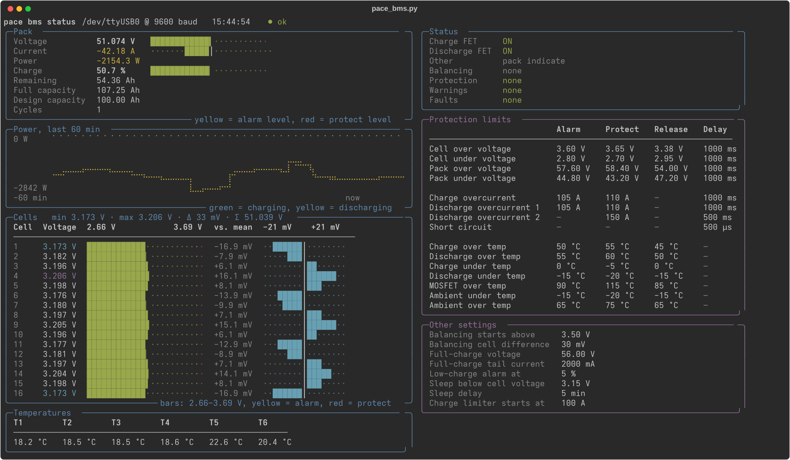

# PACE BMS RS232 monitor

> [!WARNING]
> **This code is untested AI-generated code.** It was written with the help of an
> AI assistant and has only been tried against a single battery (PowMr
> POW-LIO48100-16S). It is read-only by design, but use it at your own risk and
> review it before connecting it to hardware you care about.

`pace_bms.py` polls a PACE-based BMS (PowMr POW-LIO48100-16S and similar) over
its RS232 port and shows voltages, currents, temperatures, warnings and
protection limits. It is read-only: nothing is written to the BMS.



*Live readings from a real battery under about 2 kW load. The 60-minute power chart is
simulated for this screenshot; in normal use it fills up from the moment the program starts.*

```
./pace_bms.py -p /dev/ttyUSB0          # live view
./pace_bms.py --once --json            # single poll as JSON
```

Options: `-p` port, `-b` baud (default 9600), `-a` BMS address, `-n` pack number,
`-i` poll interval, `--no-settings`, `--json`. Needs `pyserial` and `rich`.

Serial format: 9600 baud, 8N1 (one start bit, one stop bit, no parity).

## RS232 port pinout (6P6C / RJ11 / RJ12 socket)

Hold the plug with the contacts facing you and the latch tab pointing away
from you; pin 1 is on the left.

| Pin | Signal | Direction (BMS view) | Connect to adapter |
|-----|--------|----------------------|--------------------|
| 1   | NC     | -                    | -                  |
| 2   | NC     | -                    | -                  |
| 3   | TX     | BMS transmit         | RxD                |
| 4   | RX     | BMS receive          | TxD                |
| 5   | GND    | -                    | GND                |
| 6   | NC     | -                    | -                  |

Pins 3 and 4 are crossed (null-modem style) relative to the BMS: BMS TX goes
to the adapter's RX and vice versa. No handshake lines (RTS/CTS/DTR) are used.

This differs from the RS485 and CAN ports, which are 8P8C (RJ45) sockets; do
not plug a cable into the wrong one. The RJ11 and RJ12 plugs are mechanically
fine in a 6P6C socket, but a 6P4C RJ11 plug only has pins 2-5 populated, which
is all that is needed here.

## This is real RS232, not TTL

The port uses true RS232 voltage levels, **not 3.3 V / 5 V TTL UART**.

- RS232 is inverted and bipolar: roughly -3 ... -15 V is logic 1 (mark/idle)
  and +3 ... +15 V is logic 0 (space). TTL idles high at 3.3/5 V.
- Use a **USB-to-RS232 adapter** (e.g. FTDI/Prolific/CH340 with a MAX232-type
  level shifter) with a 6P6C/RJ12 cable or breakout.
- Do **not** connect a bare USB-TTL dongle, Raspberry Pi/ESP32/Arduino UART
  pins or a CP2102/CH340 "TTL" module directly. It will not work at all
  (inverted, wrong levels), and the negative swing of the BMS output can
  damage 3.3 V / 5 V inputs.
- If you want to use a microcontroller, put a MAX3232 (3.3 V) or MAX232 (5 V)
  level converter in between.
- RS232 is only meant for short cables (a few metres at 9600 baud).

## Sources

- PACE RS232 Communication Protocol (PACE-RS232-TY16S), 2018-07-05
- PACE 16S 100Ah BMS datasheet, section 7.2 (electrical interface)
- PowMr POW-LIO48100-16S user manual V1.7

## License

MIT, see [LICENSE](LICENSE).
